# Bon Romain | Prog: Workshop 

## ex1 ne garder que du vert

 

## ex 2 echanger le canal rouge et le bleus


 


## ex 3 rendre Noir et blanc


  

## ex 4 couleurs negatif


## ex 5 degrade
#### on donne a chaque pixel la valeur : 1 - ( w - x - 1)/ w
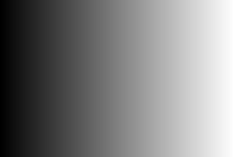

## ex 6 mirroir


## ex 7 image avec pixel aléatoire


## ex 8 image avec rotation 90 degrés


## ex 9 image split

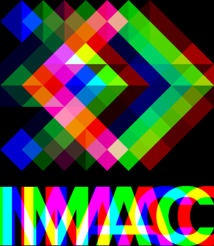

## ex 10.1 image assombris


## ex 10.2 image éclaircit


## ex 11 disque
#### la fonction prends en paramètre la taille du rayon.
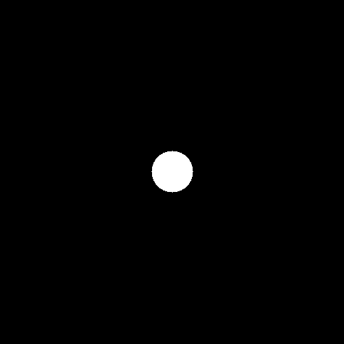

## ex 12 cercle
#### la fonction prends en paramètre l'épaisseur et la taille du rayon.

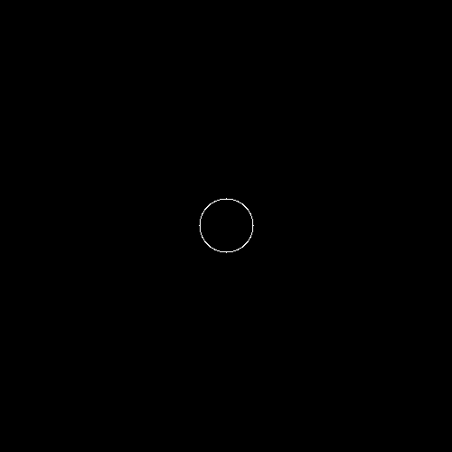

## ex 13 animation
#### la fonction prends en paramètre la taille du rayon et sa position.
on fait ensuite une boucle petit a petit pour changer cette position
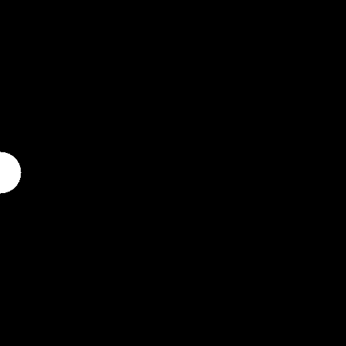

## ex 14 rosas
### on fait de la trigo pour trouver les valeurs.

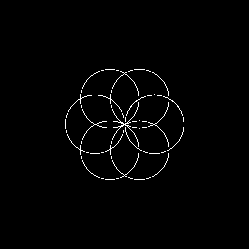

## ex 15 mosaique
#### on utilise la formule : y_modulo = (seuil * y )% h, idem pour x. le seuil est le nombre d'iteration voulut. 

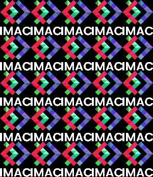

## ex 16 mosaique mirroir

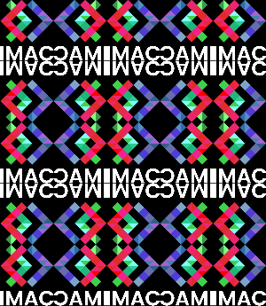

## ex 17 glitch


## ex18.1 trie via la luminance

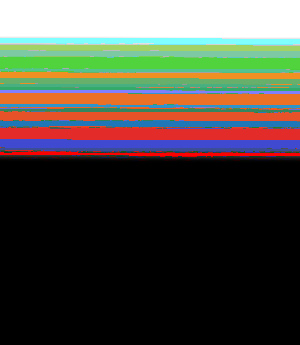

# ex 19 mandelbroot 

#### v1 sans gris :
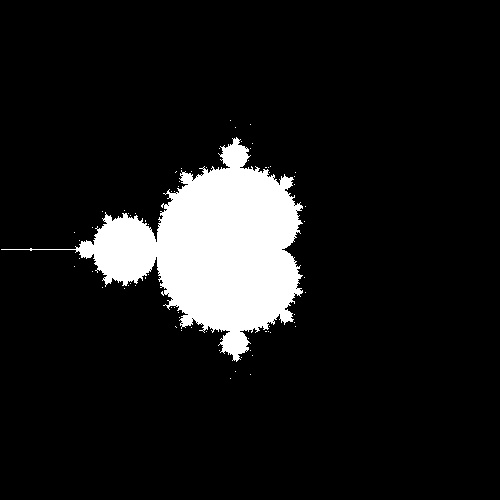

#### v2 avec cette formule 

```
if( i < 50){
    cp.pixel(x,y).r = (abs(z)-1)/2;
    cp.pixel(x,y).b = (abs(z)-1)/2;
    cp.pixel(x,y).g = (abs(z)-1)/2;
}
```

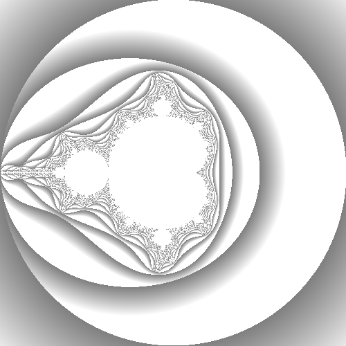

#### v3 avec cette formule 

```
if( i < 50){
    cp.pixel(x,y).r = 1-abs(z)/(2^i);
    cp.pixel(x,y).b = 1-abs(z)/(2^i);
    cp.pixel(x,y).g = 1-abs(z)/(2^i);
}
```

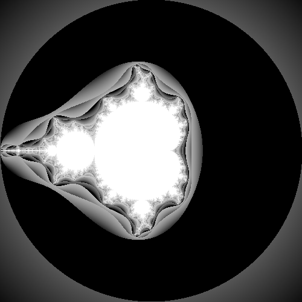
#### version finale avec i/50 tout simplement

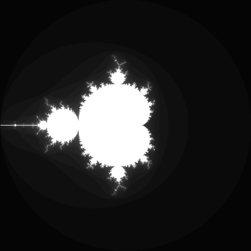


# ex20 degrade rouge-vert

#### au départ j'avais ce résultat :
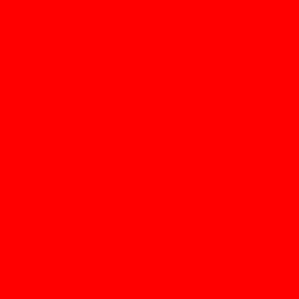

#### a cause de cette ligne, le rouge restait rouge indéfiniment.
```
cp.pixel(x, y).r = w/x ;
cp.pixel(x, y).g =  x/w;
```

#### j'ai donc fait cela 
```
cp.pixel(x, y).r = 1 - x/w ;
cp.pixel(x, y).g =  x/w;
```
#### et on obtient
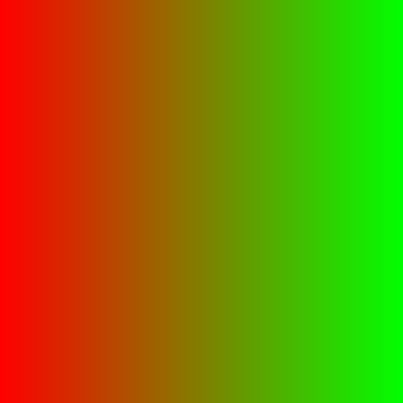

#### après avoir utilisé les conversions vers oklab linear rgb et enfin srgb. j'ai obtenu cela

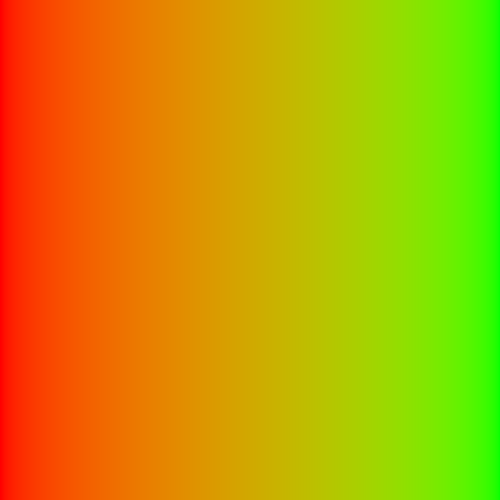

## ex 21 tramage


# ex 22 normalisation
#### j'ai procédé en 2 étapes d'abord on calcul la luminance min et max :

```
float brightnessCurrent = brightness(cp.pixel(x,y));
if ( brightnessCurrent >= brightnessMax){
    brightnessMax = brightnessCurrent;
}
if ( brightnessCurrent <= brightnessMin){
    brightnessMin = brightnessCurrent;
}
           
```

#### puis on calcul pour chaque pixel sa nouvelle valeur r,v,b :

           
```
cp.pixel( x, y ).r = (cp.pixel( x, y ).r - brightnessMin) / (brightnessMax - brightnessMin);
```

#### et le résultats :


## ex 23 vortex

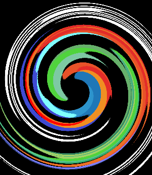

## ex24 convolution

#### j'ai pris 1/9 comme ratio et regardé autour des 9 pixels les plus proches .

#### j'ai appliqué la couleur noir et valeur 0 pour les éléments en dehors de l'image.


## ex25 kuwahara

#### j'ai découper en 4 carrés chaque pixel
#### 4 carré 
- en haut a droite

```
for (int i{0}; i < mid; i++)
  {
  for (int j{0}; i < mid; j++){
    ...

```
- en haut a gauche 
```
for (int i{mid+1}; i < n i++)
  {
  for (int j{0}; i < mid; j++){
    ...

```
- en bas a droite

```
for (int i{0}; i < mid; i++)
  {
  for (int j{mid+1}; j < n; j++){
    ...

```
- en bas a gauche
```
for (int i{mid+1}; i < n; i++)
  {
  for (int j{mid+1}; j < n; j++){
    ...

```

#### ensuite je fais 2 boucle dans ces carrés pour savoir lesquels sont les plus homogènes puis j'assigne la moyenne du carré avec le moins d'écart : 
```
if (averageDist < min) {
  min = averageDist;
  pixelMin = average;
}
cp.pixel( x, y) = pixelMin;
```

#### et le resultats :


## ex 26 diamondSquare 

#### au départ je faisait en recurrence et je me suis retrouvé bloquer avec ce resultat.

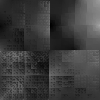

#### ma recurrence faisait cela

```
ecart *= 0.25f;
image = diamondSquareRec( step / 2, image, centerX, endW, centerY, endH, ecart );
image = diamondSquareRec( step / 2, image, startW , centerX, startH, centerY, ecart);
image = diamondSquareRec( step / 2, image, startW , centerX, centerY, endH, ecart);
image = diamondSquareRec( step / 2, image, centerX , endW , startH, centerY, ecart);
```

 #### je modifiais des blocs indépendemment des autres

#### j'ai donc adapter l'appel de recurrence pour traiter chaque carré, losanges d'une seule étapes, d'un seul coup

```
  for(float i{0}; i < image.width() -step ; i = i + step){
    for(float j{0}; j < image.height() -step ; j = j + step){
      ....
    }
  }
  return diamondSquareRec( mid, image, ecart ); 
```
#### avec comme résultats :
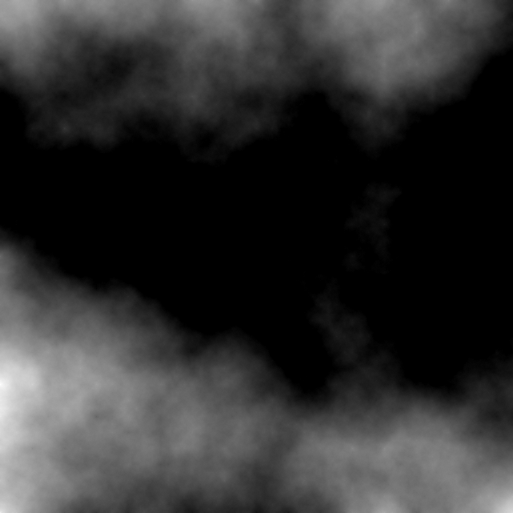

#### avec les couelurs
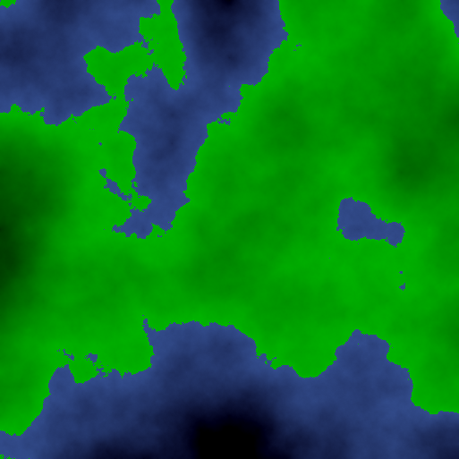
